<div align="center">

<picture>
  <source media="(prefers-color-scheme: dark)" srcset="docs/assets/logo-dark.png">
  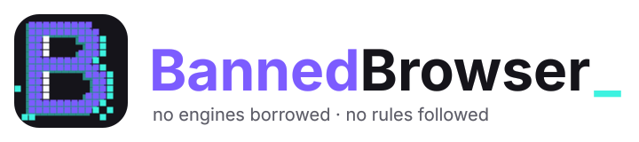
</picture>

### A web browser hacked together from scratch in Rust. No engines borrowed, no rules followed.

[](https://github.com/imm0nv1nhtv/BannedBrowser/actions/workflows/ci.yml)
[](https://github.com/imm0nv1nhtv/BannedBrowser/releases)


[Download](#-getting-started) · [Build](#-getting-started) · [Features](#-features) · [Screenshots](#-screenshots) · [Roadmap](#-roadmap) · [FAQ](#-faq)

</div>

---

> **Status: early development (pre-v0.1).** BannedBrowser renders example.com and
> 1990s-style sites like theoldnet.com convincingly, but it has no JavaScript,
> cookies, bookmarks or sandboxing yet. See [PROGRESS.md](PROGRESS.md) for the honest details.

## 📑 Contents

- [Screenshots](#-screenshots)
- [Why "BannedBrowser"?](#-why-bannedbrowser)
- [What makes it different](#-what-makes-it-different)
- [Features](#-features)
- [Web compatibility snapshot](#-web-compatibility-snapshot)
- [Architecture](#-architecture)
- [Getting started](#-getting-started)
- [Usage](#-usage)
- [Testing](#-testing)
- [Roadmap](#-roadmap)
- [FAQ](#-faq)
- [Contributing](#-contributing)
- [Acknowledgements](#-acknowledgements)
- [License](#-license)

## 📸 Screenshots

<div align="center">
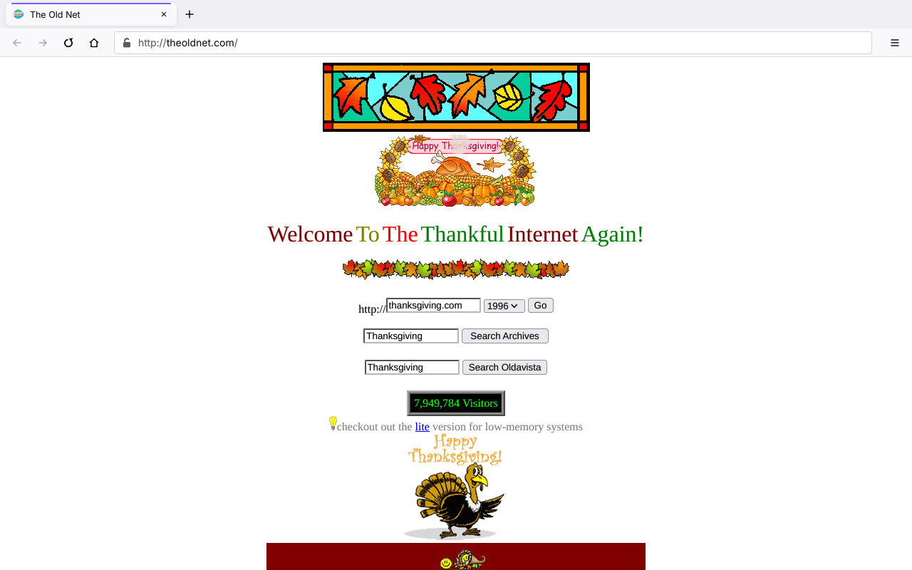
<br><sub>theoldnet.com — tables, <code>&lt;font&gt;</code>, <code>&lt;center&gt;</code>, GIFs and form controls, all laid out and painted by BannedBrowser's own engine.</sub>
</div>

| | |
|---|---|
| 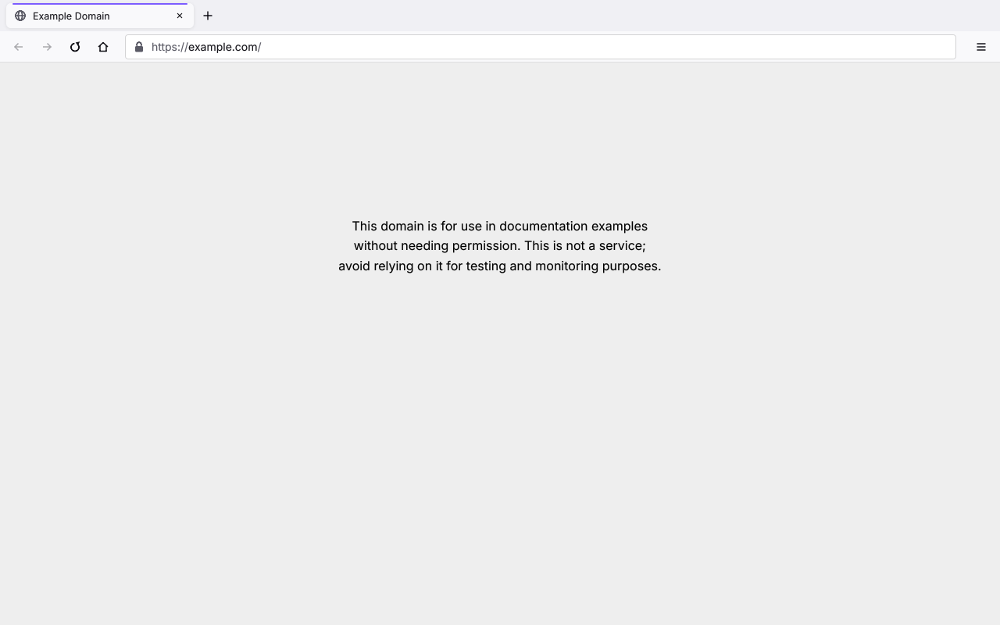 <br> example.com (light) | 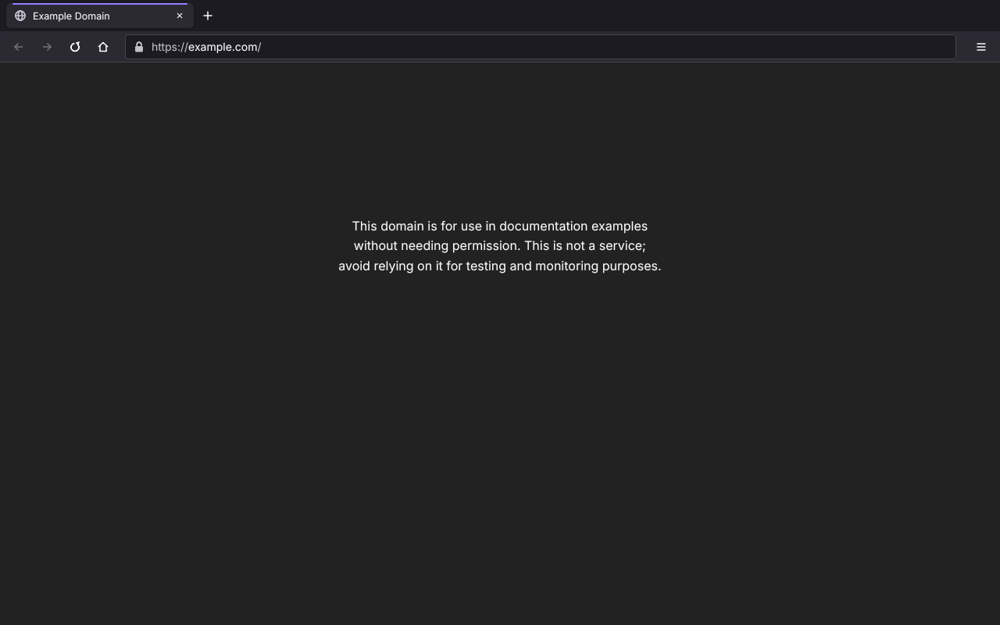 <br> example.com honouring `color-scheme` + `light-dark()` (dark) |
| 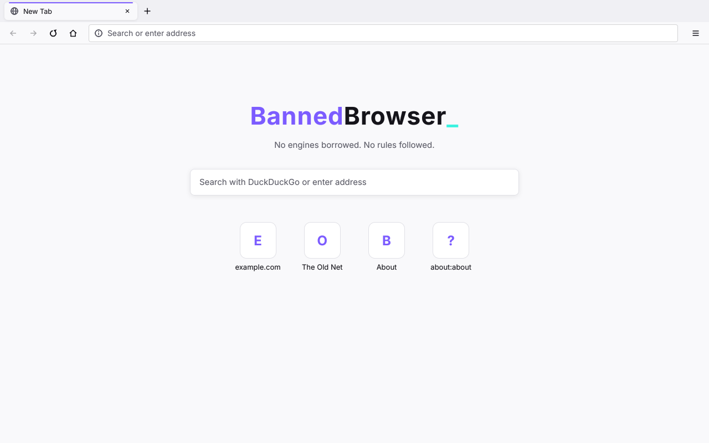 <br> New-tab page (rendered by our engine) | 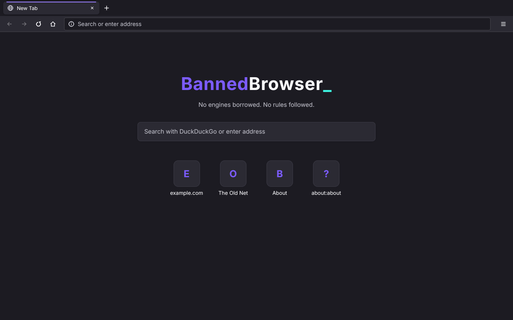 <br> New-tab page, dark theme |
| 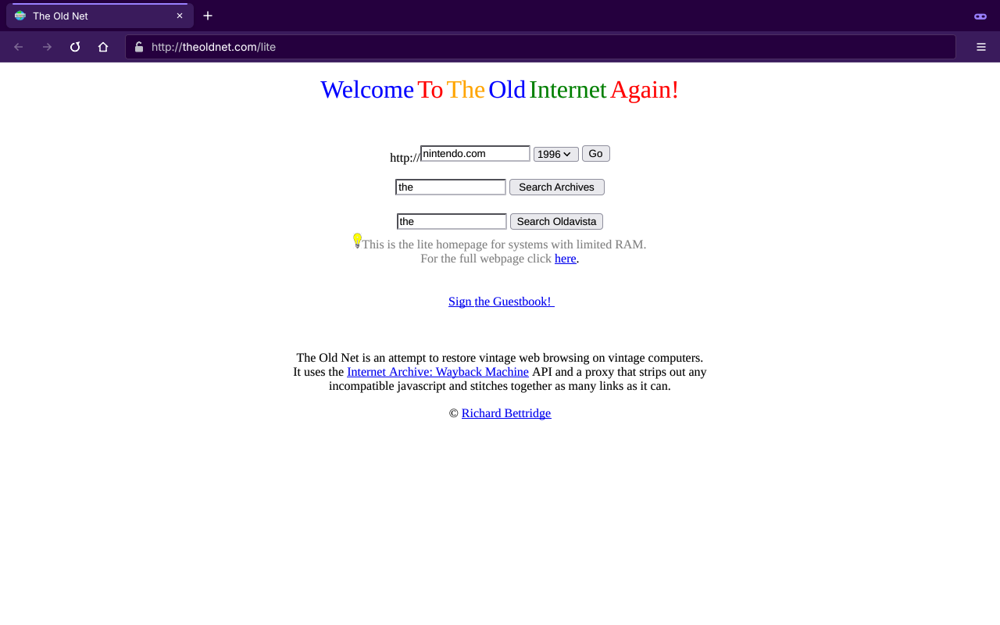 <br> Private window (dark-violet frame) | 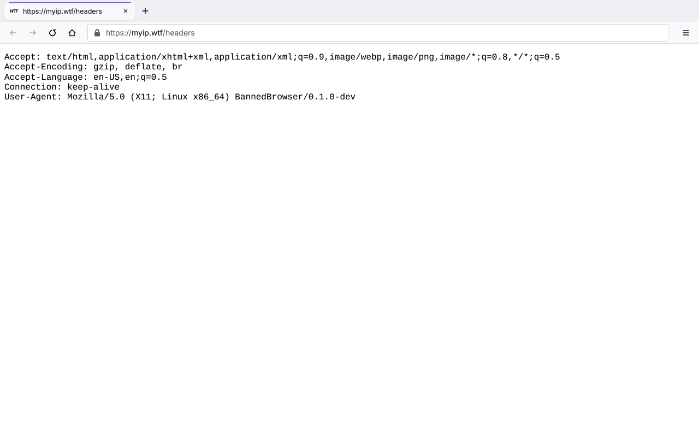 <br> https://myip.wtf/headers — what we send |
| 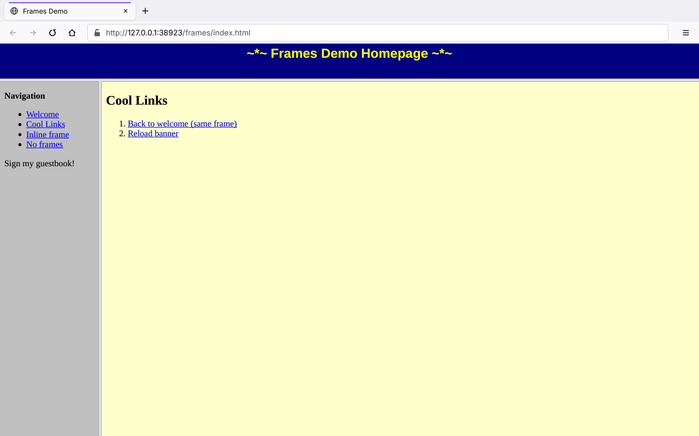 <br> A `<frameset>` page after clicking a `target="main"` link | 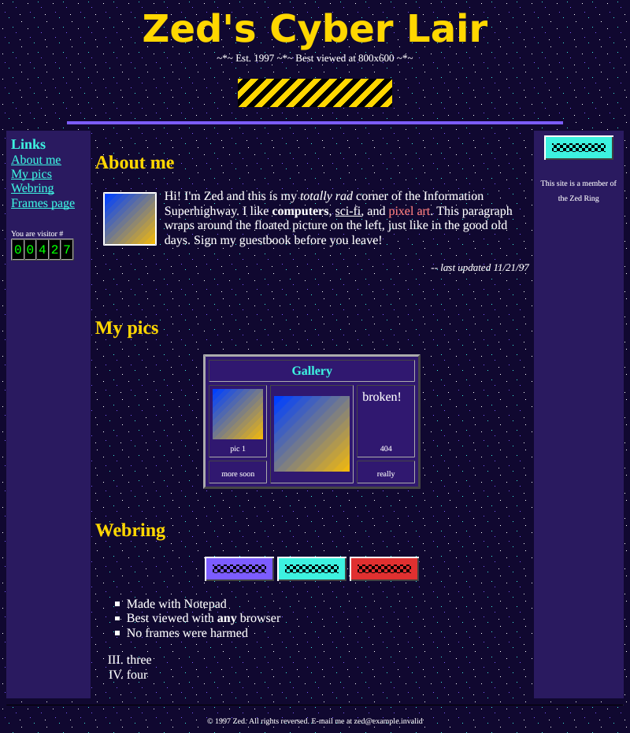 <br> Our own 1990s-style test page (original artwork) |
| 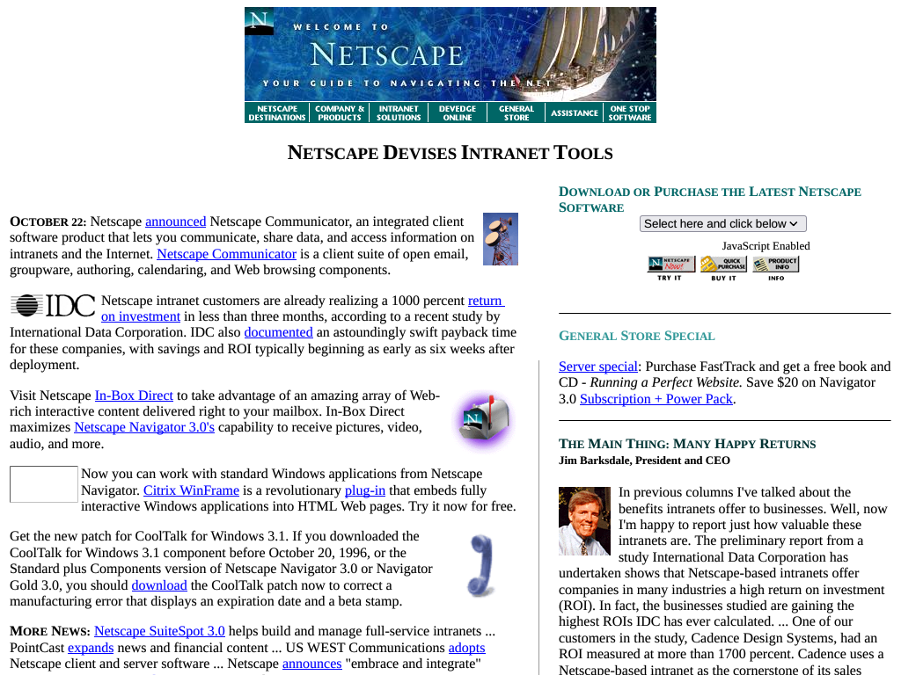 <br> netscape.com as archived in Oct 1996 (via theoldnet.com) | 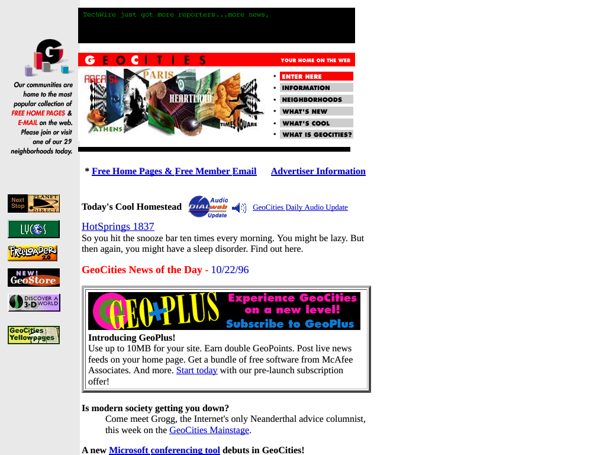 <br> geocities.com as archived in Oct 1996 (via theoldnet.com) |

<details>
<summary>More: example.com with its JavaScript-inserted translations applied by hand (Arabic RTL, CJK, Cyrillic)</summary>

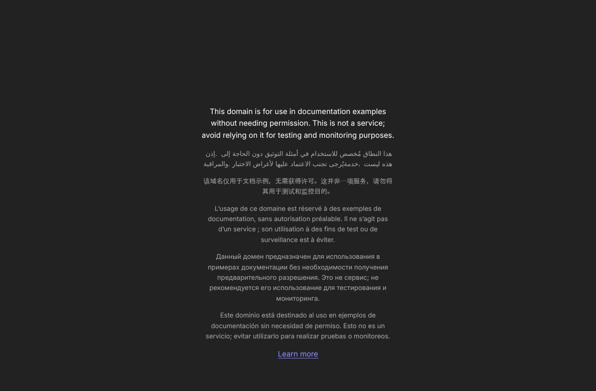

</details>

All screenshots are real captures (`vshot` under Xvfb + Fluxbox, or `--headless --screenshot`). No mock-ups.

## 🐺 Why "BannedBrowser"?

The name is a nod to **Silver Wolf** (银狼, *Yín Láng*) from ***Honkai: Star Rail***, whose
handle is **`@Banned_Player`** ([character wiki](https://honkai-star-rail.fandom.com/wiki/Silver_Wolf)).
She is a member of the Stellaron Hunters and a genius hacker who has mastered "Aether Editing"
to tamper with the data of reality, and who views the universe as a massive immersive
simulation game ([Wikipedia](https://en.wikipedia.org/wiki/Silver_Wolf_(Honkai:_Star_Rail))).
It fits the project's spirit: a browser that *bans* borrowed engines and builds every piece
of the web platform from scratch, just to see if it can.

> *BannedBrowser is an unofficial fan-named project and is not affiliated with, endorsed by,
> or sponsored by HoYoverse. Honkai: Star Rail and Silver Wolf are trademarks of their
> respective owners.* No game art, character images or logos are used anywhere in this project.

## 🧪 What makes it different

Most "new browsers" are a skin on Chromium, Gecko or WebKit. BannedBrowser writes the
web platform itself — and enforces it: [`scripts/check-deps.sh`](scripts/check-deps.sh)
fails the build if `cargo tree` contains html5ever, cssparser, selectors, taffy,
cosmic-text, tiny-skia, url, hyper, reqwest, egui, gtk, servo, boa, … (full list in
[CLAUDE.md](CLAUDE.md)).

| We wrote it ourselves | We use a crate for it |
|---|---|
| WHATWG URL parser, IDNA, Punycode | Windows & input: `winit`; pixels to screen: `softbuffer` |
| HTTP/1.1 client, keep-alive pool, chunked, redirects, proxies, `data:`/`file:`/`about:` | TLS: `rustls` (ring) + `webpki-roots` |
| HTML tokenizer + tree builder (all insertion modes) | Decompression: `flate2`, `brotli-decompressor` |
| DOM | Text encodings: `encoding_rs` |
| CSS tokenizer, parser, selectors, media queries, cascade, `calc()`, `var()` | Font files/discovery: `fontdb` (+`ttf-parser`) |
| Block/inline/float/table/flex/positioned layout | Shaping: `rustybuzz`; Unicode tables: `unicode-*` |
| Anti-aliased rasterizer, gradients, shadows, clipping, glyph cache | Image codecs: `png`, `zune-jpeg`, `gif`, `image-webp` (BMP/ICO are ours) |
| The browser chrome toolkit and icons | Clipboard: `arboard` |

See [DEPENDENCIES.md](DEPENDENCIES.md) for every crate and why.

## ✨ Features

Legend: ✅ working · 🚧 partial · 📋 planned

<details open>
<summary><b>Browsing, tabs & windows</b></summary>

| Feature | Status |
|---|---|
| Tabs (new, close, middle-click close, reopen closed, Ctrl+Tab, Ctrl+1…9) | ✅ |
| Multiple windows, private windows | ✅ |
| Back / forward / reload / home, URL bar with editing + IME | ✅ |
| Link hover status + pointer cursor, click / Ctrl+click (background tab), `target=_blank` | ✅ |
| Wheel and keyboard scrolling, overlay scrollbar (drag, track paging) | ✅ |
| Favicons, loading throbber + progress line, page title in tab and window | ✅ |
| Light / dark theme following the OS (`--dark` / `--light` override) | ✅ |
| Find in page (Ctrl+F) with highlights and match counter | ✅ |
| ≡ app menu, context menus, sidebars | 📋 |
| Session restore, pinned tabs, drag to reorder | 📋 |

</details>

<details>
<summary><b>Bookmarks · History · Downloads · Privacy · Search · Reader View · DevTools</b></summary>

| Feature | Status |
|---|---|
| Bookmarks (toolbar, menu, Library, HTML import/export) | 📋 M9 |
| History with frecency, sidebar, Library | 📋 M9 |
| Downloads manager | 📋 M9 |
| Private browsing (separate in-memory state) | 🚧 windows exist; no persistent state is written yet anyway |
| Search engines + keywords | 🚧 non-URL input searches DuckDuckGo |
| Reader View | 📋 M9 |
| View source, DevTools, Browser Console | 📋 M11 |

</details>

<details open>
<summary><b>Web platform</b></summary>

| Area | Status |
|---|---|
| URL Standard | ✅ 100 % WPT urltestdata |
| HTTP/1.1, HTTPS, gzip/deflate/br, chunked, redirects, proxies | ✅ |
| Cookies, cache | 📋 M8 |
| HTML parsing | ✅ 99.6 % / 99.7 % html5lib |
| Legacy presentational attributes, quirks mode | ✅ |
| CSS selectors, cascade, custom properties, `calc()`, media queries | ✅ |
| Colors incl. `light-dark()`, `hsl()`, `hwb()`, legacy color parsing | ✅ |
| Block, inline, floats, margin collapsing | ✅ |
| HTML tables (colspan/rowspan, auto + fixed) | ✅ |
| Flexbox | 🚧 basic |
| Positioning (relative/absolute) | ✅ · fixed/sticky 🚧 |
| Images (PNG, JPEG, GIF, WebP, BMP, ICO), image maps | ✅ (GIF animation 📋) |
| Fonts: system fonts, fallback (CJK, Thai, Arabic, emoji) | ✅ · `@font-face` 📋 |
| Bidi text | 🚧 basic reordering |
| Frames: `<frameset>`, `<iframe>` (src/srcdoc), link targets, per-frame scrolling | ✅ (frame navigations not in history yet) |
| SVG | 📋 |
| JavaScript | 📋 M10 (own engine) |

</details>

## 🌐 Web compatibility snapshot

| Site | Status |
|---|---|
| example.com | ✅ (static HTML; its JS-added translations need M10) |
| theoldnet.com (start page + lite) | ✅ |
| myip.wtf, myip.wtf/headers | ✅ |
| Archived 1996–99 sites via theoldnet: GeoCities (home + a fan page), Netscape, WinZip, Microsoft IE | ✅ live + offline snapshots |
| Wikipedia, Hacker News | 📋 not tested yet |

| Test suite | Pass rate |
|---|---|
| WPT urltestdata | **904 / 904 (100 %)** |
| html5lib tokenizer | **7014 / 7042 (99.60 %)** |
| html5lib tree construction | **1779 / 1784 (99.72 %)** |
| Reftests | **48 / 48** |
| test262 | 📋 (M10) |

## 🏗 Architecture

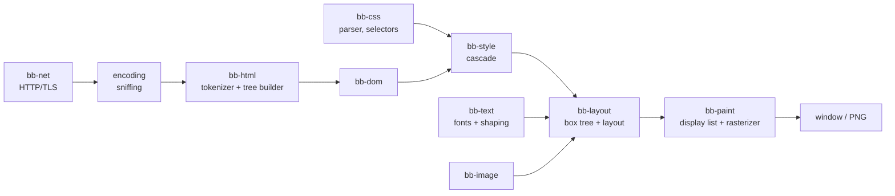

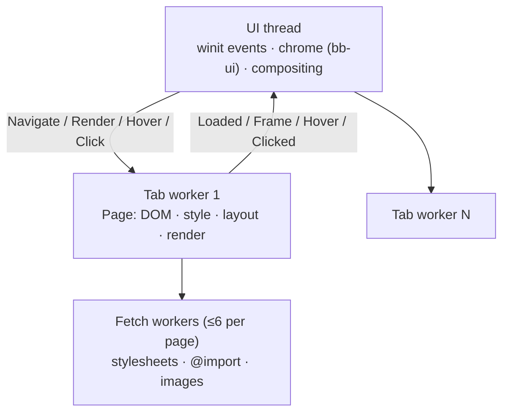

| Crate | What it does |
|---|---|
| `bb-url` | WHATWG URL parser & serializer |
| `bb-net` | HTTP/1.1, TLS, proxies, content codings, `data:`/`file:`/`about:`, encoding sniffing |
| `bb-dom` | Arena DOM with dirty flags |
| `bb-html` | HTML tokenizer & tree builder |
| `bb-css` | CSS syntax, selectors, media queries, values |
| `bb-style` | Cascade, computed values, UA stylesheet, presentational hints |
| `bb-text` | Font discovery, fallback, shaping, line breaking |
| `bb-image` | Image decoding |
| `bb-paint` | Display list & software rasterizer |
| `bb-layout` | Box tree, layout, display-list generation, hit testing |
| `bb-engine` | Per-page pipeline |
| `bb-ui` | Chrome widget toolkit & icons |
| `bb-js` | JavaScript engine (M10) |
| `bannedbrowser` | The app: CLI, headless mode, windowed shell |

More in [docs/ARCHITECTURE.md](docs/ARCHITECTURE.md).

## 🚀 Getting started

**Prebuilt binaries:** see [Releases](https://github.com/imm0nv1nhtv/BannedBrowser/releases)
(Windows `.zip`, macOS `.app` zip, Linux tarball) once v0.1 is tagged.

**Build from source** (stable Rust 1.85+):

```bash
cargo run --release -- https://example.com
```

<details>
<summary>Windows</summary>

Install Rust via [rustup](https://rustup.rs) with the MSVC toolchain (Visual Studio Build
Tools, "Desktop development with C++"), or the GNU toolchain with MinGW-w64. No other
dependencies.

</details>

<details>
<summary>macOS</summary>

Install the Xcode Command Line Tools (`xcode-select --install`) and Rust via rustup.

</details>

<details>
<summary>Linux</summary>

```bash
# Debian / Ubuntu
sudo apt install build-essential pkg-config libxkbcommon-dev libwayland-dev libx11-dev fontconfig fonts-dejavu-core
# Fedora
sudo dnf install gcc pkgconf-pkg-config libxkbcommon-devel wayland-devel libX11-devel fontconfig dejavu-sans-fonts
# Arch
sudo pacman -S base-devel libxkbcommon wayland libx11 fontconfig ttf-dejavu
```

</details>

## 🕹 Usage

```text
bannedbrowser [OPTIONS] [URL]...
  --headless                 Render without a window
  --screenshot <FILE.png>    Write a PNG of the page (implies --headless)
  --window-size <WxH>        Window / viewport size in CSS px (default 1280x800)
  --full-page                Screenshot the whole document
  --scale <N>                Device pixel ratio for screenshots
  --dump-dom | --dump-style | --dump-layout   Print a pipeline stage and exit
  --dark | --light           Force the color scheme
  --extra-ca <FILE.pem>      Trust an extra CA bundle (also honours SSL_CERT_FILE)
  --private-window           Open a private window
  --new-tab <URL>            Open URL in a new tab
  --profile <DIR>            Profile directory (used from M8)
```

HTTPS/HTTP proxies are taken from `HTTPS_PROXY`, `HTTP_PROXY`, `ALL_PROXY` and `NO_PROXY`.

| Action | Windows / Linux | macOS |
|---|---|---|
| Focus URL bar | Ctrl+L, Alt+D, F6 | Cmd+L |
| New tab / close tab / reopen closed tab | Ctrl+T / Ctrl+W / Ctrl+Shift+T | Cmd+T / Cmd+W / Cmd+Shift+T |
| New window / private window | Ctrl+N / Ctrl+Shift+P | Cmd+N / Cmd+Shift+P |
| Next / previous tab | Ctrl+Tab / Ctrl+Shift+Tab | Ctrl+Tab / Ctrl+Shift+Tab |
| Go to tab 1…8 / last | Ctrl+1…8 / Ctrl+9 (Alt+1…9) | Cmd+1…8 / Cmd+9 |
| Back / forward | Alt+← / Alt+→ | Cmd+[ / Cmd+] |
| Reload | Ctrl+R, F5 | Cmd+R |
| Home | Alt+Home | Alt+Home |
| Scroll | Space, Shift+Space, PageUp/Down, arrows, Home/End | same |
| Quit | Ctrl+Q | Cmd+Q |

**`about:` pages:** `about:newtab`, `about:home`, `about:blank`, `about:bannedbrowser`, `about:about`.

**Profile location** (used from M8): `%APPDATA%\BannedBrowser`, `~/Library/Application Support/BannedBrowser`, `~/.config/bannedbrowser`.

## 🧾 Testing

```bash
scripts/fetch-spec-tests.sh            # html5lib-tests, WPT urltestdata, entities.json → third_party/
cargo test --workspace                 # unit, spec, integration, robustness, reftests, snapshots
scripts/run-reftests.sh                # reftests only (diff PNGs in tests/reftests/out/)
scripts/gui-smoke.sh                   # GUI tests under Xvfb + Fluxbox (xdotool)
scripts/check-deps.sh                  # the no-borrowed-engines rule
```

The Claude Code cloud VM provides `vdisplay-start` (Xvfb `:99` + Fluxbox), `vshot` and
`vwait-window`. GUI tests assert on the JSON the browser writes to `$BB_TEST_STATE`.
Details: [docs/TESTING.md](docs/TESTING.md).

## 🗺 Roadmap

- [x] **v0.1 "Hello, Old Web"** — example.com ✅, theoldnet.com ✅, 5 archived sites ✅, CI on 3 OSes ✅, release packages ✅
- [x] M0 Scaffold
- [x] M1 URL & networking
- [x] M2 HTML
- [ ] M3 CSS & style (mostly done)
- [ ] M4 Layout I (mostly done)
- [ ] M5 Paint (mostly done; 48 reftests)
- [ ] M6 GUI shell core (started)
- [ ] M7 Layout II (grid, transforms, `@font-face`, …)
- [ ] M8 Forms, cookies, cache, profile storage
- [ ] M9 Bookmarks, history, downloads, settings, Reader View, passwords
- [ ] M10 JavaScript engine
- [ ] M11 DevTools, performance, accessibility, packaging

## ❓ FAQ

**Why not use Servo / a WebView?** Because then it would be someone else's browser. The whole point is to build the platform ourselves.

**Is it safe for daily browsing?** Not yet. There is no sandboxing or process isolation, no JavaScript (which is safer but breaks many sites), and no cookies. Treat it as an experiment.

**Does it run JavaScript?** Not yet — milestone M10 brings a from-scratch engine (`bb-js`). Until then `<script>` is ignored and `<noscript>` content is shown.

**Why Rust?** Memory safety for parsers that eat hostile input all day, great tooling, and fearless threading for the per-tab pipelines. Every engine crate is `#![forbid(unsafe_code)]`.

**Why does it look like Firefox?** The chrome is inspired by Firefox's Proton design (floating tabs, roomy URL bar, ≡ menu). It uses no Mozilla code, names, icons or artwork and is not affiliated with Mozilla.

## 🤝 Contributing

Read [docs/CONTRIBUTING.md](docs/CONTRIBUTING.md). In short: no web-platform crates
(check-deps enforces it), `cargo fmt` + `clippy -D warnings`, cite spec sections, add a
reftest for rendering changes, and use conventional commits (`feat(layout): …`).

## 🙏 Acknowledgements

- The **WHATWG** and **CSSWG** specifications, **html5lib-tests**, **Web Platform Tests** and **test262**.
- **Firefox / Mozilla** for UI inspiration (not affiliated).
- The authors of `winit`, `softbuffer`, `rustls`, `ring`, `fontdb`, `ttf-parser`, `rustybuzz`, `encoding_rs`, the image codecs and the other crates we rely on.
- **Silver Wolf / Honkai: Star Rail** for the name (unofficial fan reference; see above).

## 📄 License

Licensed under either of [MIT](LICENSE-MIT) or [Apache-2.0](LICENSE-APACHE), at your option.
